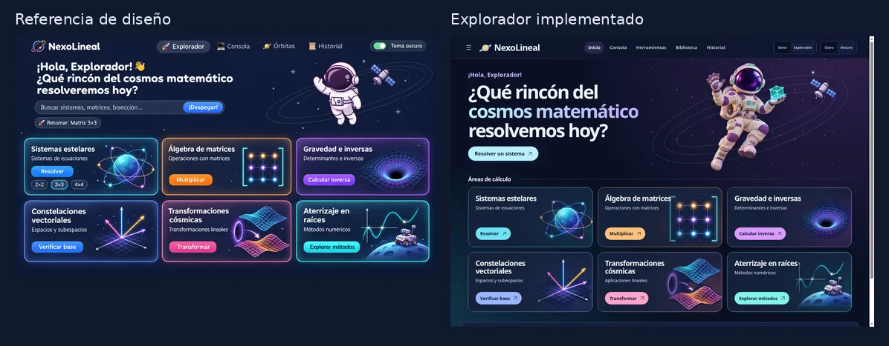
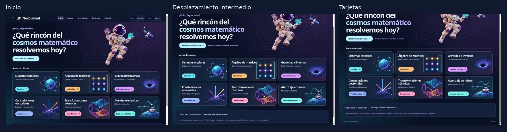

# Menú y Sistemas · Revisión 01

[Probar la versión de revisión](https://nexolineal-explorador.cheekykiwi264.chatgpt.site) · [Pruebas de aceptación en GitHub](https://github.com/Rolando8-03/NexoLineal/actions/workflows/rediseno01.yml)

Abrí **Resolver un sistema**, pulsá **Cargar ejemplo** y después **Resolver**. El motor devuelve x = 2, y = 1. En **Comprobación en el sistema original**, abrí la sustitución para ver qué da cada fila.

| Prueba en Serio y Explorador | Resultado |
| --- | --- |
| Análisis completo del ejemplo | x = 2, y = 1. Los términos independientes son 3 y 1. |
| Solución y comprobación de un sistema dependiente | (3, 0) + t(−1, 1). La particular da (3, 6) y la dirección da (0, 0). |
| Solo rangos para un sistema incompatible | Rangos 1 y 2. Al añadir Clasificación, se explica la contradicción. |
| Gauss-Jordan para dos ecuaciones y tres incógnitas | Se conserva la aumentada de dos filas que ya estaba reducida. |
| Solo solución para 2x = 1 | x = 1/2 exacto. |

El material de G1, G4 y las secciones pertinentes de los cuatro libros se consultan desde **Cómo interpretar un sistema lineal**. Allí se desarrolla un modelo de tránsito con una variable libre. Para las operaciones y casos de la calculadora original se usaron las copias de `js/app.js`, `python/analisis_sistema.py` y `GUIA_DE_USO.md` del repositorio.

## Portada de escritorio

[Ver la captura de escritorio a tamaño completo](inicio.webp)

## Escena durante el desplazamiento

## Pantalla móvil y resultados

[Portada móvil](movil.webp) · [Editor con altura reducida](editor-movil.webp) · [Resultado de un cálculo](resultado.webp)

Las capturas móviles usan un marco de 390 × 844 píxeles en Chrome de escritorio. Para la edición se redujo la altura a 420 píxeles y se escribió una fracción. Queda pendiente la comprobación del teclado virtual en un teléfono físico. El flujo de GitHub Actions genera también capturas con el movimiento reducido del navegador.
